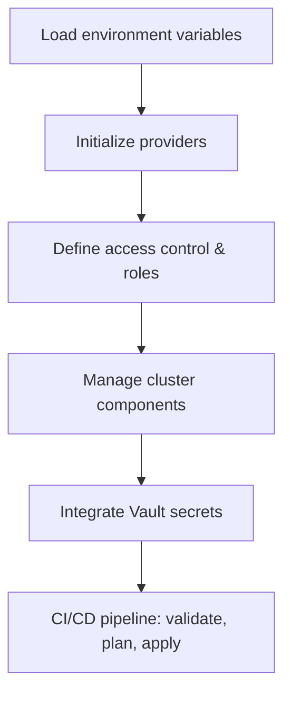

# Rancher Access Management | Overview & Workflow

## Purpose

- Centralize and automate Rancher access management.
- Support multi-organization and multi-environment deployments.
- Ensure secure secret handling via Vault.
- Provide a clear structure for all team members to understand and contribute.

---
## Directory Structure

The `access-mgmt` directory is designed for managing Rancher cluster access and permissions using Terraform. It is organized to support multiple organizations and environments, with modular configuration and secret management.

### Top-Level Files

- **.gitlab-ci.yml**  
  Defines CI/CD pipeline for automated validation, planning, and deployment of Terraform changes.

- **main.tf**  
  Entry point for Terraform configuration, includes module and resource definitions.

- **provider.tf**  
  Specifies providers (Rancher, Vault, etc.) required for resource management.

- **variables.tf**  
  Declares input variables for the Terraform project.

- **locals.tf**  
  Defines local values for use throughout the configuration.

- **outputs.tf**  
  (Not present, but typically used for outputting resource attributes.)

- **access_control.tf**  
  Manages access control rules and policies for Rancher clusters.

- **roles.tf**  
  Defines roles and role bindings for Rancher users and groups.

- **clusters-components.tf**  
  Manages cluster-level components and their access permissions.

- **vault-secrets.tf**  
  Integrates Vault for secure secret management and distribution.

### variable.d/

Contains organization and environment-specific configuration:

- **lumi/**  
  - **local/**:  
    - `backend.conf`: Backend configuration for state management.  
    - `variables.tfvars`: Variable values for the local environment.

- **starix/**  
  - **kbt/**, **local/**, **prod/**, **sit/**:  
    - Each contains `backend.conf` and `variables.tfvars` for respective environments.

#### Example: `starix/prod/variables.tfvars`

- **cluster_org** and **cluster_env**:  
  Identify the organization and environment.

- **clusters_ac**:  
  Maps clusters to projects, each with roles and group memberships for fine-grained access control.

- **user_groups**:  
  Defines user groups, their admin status, and members.

- **vault_secrets**:  
  Specifies Vault mount and path for Rancher credentials.

## How It Works

1. **Environment Selection**  
   - The appropriate configuration is loaded from `variable.d` based on organization and environment.

2. **Provider Initialization**  
   - Providers for Rancher and Vault are initialized via `provider.tf`.

3. **Access Control & Roles**  
   - Access rules and roles are defined in `access_control.tf` and `roles.tf`, using data from `variables.tfvars`.

4. **Cluster Components**  
   - Cluster-level resources and their access are managed in `clusters-components.tf`.

5. **Secret Management**  
   - Vault integration in `vault-secrets.tf` ensures secrets are securely managed and distributed.

6. **CI/CD Automation**  
   - `.gitlab-ci.yml` automates the workflow: validate, plan, apply, and manage state.

## Workflow Chart

